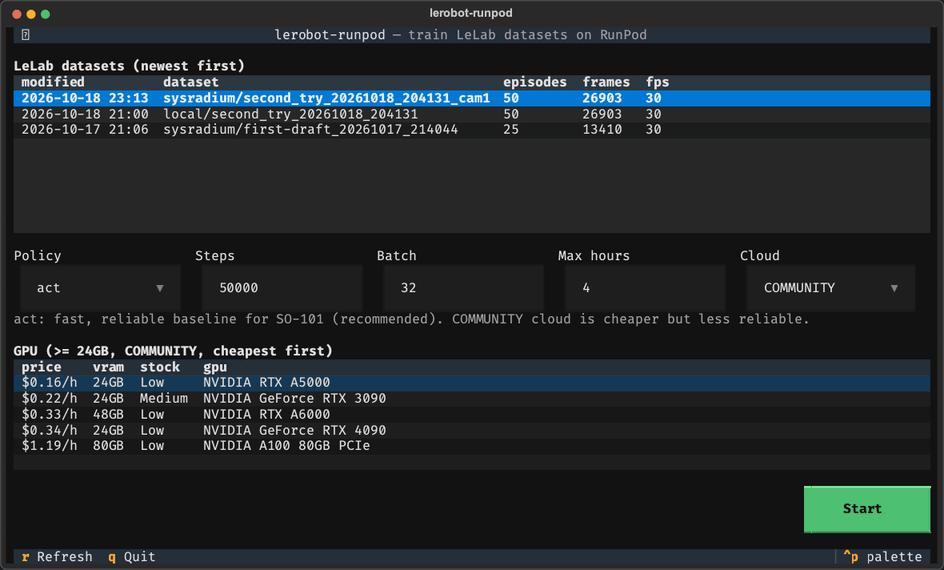

# lerobot-runpod

Train [LeRobot](https://github.com/huggingface/lerobot) policies on [RunPod](https://www.runpod.io) GPUs
from datasets you recorded in **LeLab**, and get the trained model back into LeLab as a finished run.



```
LeLab dataset ──> (Hub, private) ──> RunPod pod: lerobot-train ──> model pushed to a private HF repo
                                                                         │
LeLab "Training" list <── ~/.cache/huggingface/lerobot/outputs/train <───┘ hf download
```

It shells out to the `runpodctl` and `hf` CLIs (no API reimplementation), has a small Textual TUI,
and a scriptable CLI that uses the same code.

## Requirements

- Python 3.12+ and [uv](https://docs.astral.sh/uv/)
- [`runpodctl`](https://github.com/runpod/runpodctl), configured with your API key
- `hf` (huggingface_hub CLI), logged in with a token that can write (`hf auth login`)
- LeLab, for recording datasets and running the trained policy

## Install

```bash
uv tool install .            # from a checkout
lerobot-runpod --help
```

For development: `make sync`, then `make check` (lint + tests); `make help` lists all targets, including `make plan DATASET=...` for a dry run.

## Usage

### TUI

```bash
lerobot-runpod
```

Setup screen: your running `lerobot-*` pods (refreshed every 30 s; **Attach** opens the run screen
for one, e.g. after the laptop was closed), then a dataset from LeLab's cache (newest first), a
policy, steps/batch/max hours (filled with per-policy defaults), the cloud, and a GPU (filtered by the
policy's minimum VRAM, cheapest first). **Start** runs the pre-flight checks and shows the full plan,
including the worst-case cost, before anything is created.

Run screen: stage indicator (`pod > starting > install > env > download > train > done`), progress bar
with step/ETA/it-s, the last loss line, and the scrolling pod log. `x` stops training and deletes the
pod; `q` quits and asks whether to delete a still-running pod (default: yes).

### CLI

```bash
# print the plan and the (token-redacted) pod command, create nothing
lerobot-runpod train --dry-run --dataset sysradium/second_try_cam1 --policy smolvla \
    --steps 10000 --cloud community --gpu "NVIDIA GeForce RTX 3090"

# for real; --yes skips the final confirmation, the GPU defaults to the cheapest fit
lerobot-runpod train --dataset local/pick_cube --policy act --push-dataset --yes

lerobot-runpod datasets                  # LeLab datasets in the local cache
lerobot-runpod gpus --min-vram 80        # GPUs with prices
lerobot-runpod pods                      # your lerobot-* pods
lerobot-runpod attach [<pod-id>]         # follow a running pod and deliver its model when it finishes
lerobot-runpod pods --delete <pod-id>    # or --delete-all
lerobot-runpod fetch sysradium/act_pick_cube_20261018_2141   # deliver an already-trained model
lerobot-runpod rename-camera local/pick_cube front camera1   # copy a dataset with a camera renamed
```

`pods`, `attach` and `fetch` cover the "laptop was closed mid-run" case: the pod keeps training,
pushes the model to the Hub on its own and deletes itself afterwards. `attach` picks a still-running
pod back up (it rebuilds the plan from the env vars the pod was created with) and refuses if another
process is already following it; `fetch` brings in a model whose pod is already gone.

### Policies

| policy    | default steps | batch | min VRAM | max hours | notes                                  |
|-----------|---------------|-------|----------|-----------|----------------------------------------|
| act       | 50000         | 32    | 24 GB    | 4         | fast, reliable baseline for SO-101     |
| diffusion | 100000        | 64    | 24 GB    | 8         |                                        |
| smolvla   | 20000         | 32    | 24 GB    | 6         | fine-tuned from `lerobot/smolvla_base` |
| pi0       | 30000         | 32    | 80 GB    | 8         | fine-tuned from `lerobot/pi0_base`     |

Adding one is a row in `src/lerobot_runpod/policies.py`.

## How it integrates with LeLab

- **Datasets** are read from LeLab's cache, `~/.cache/huggingface/lerobot/<owner>/<name>` (or
  `$HF_LEROBOT_HOME`). The pod can only download from the Hub, so `local/<name>` maps to
  `<your-hf-user>/<name>`. If it isn't on the Hub yet you're asked whether to push it as a **private**
  dataset (CLI: `--push-dataset`). Pushing needs `lerobot`; it runs in your local lerobot checkout if
  there is one, otherwise in a throwaway `uv run --with lerobot` environment.
- **Results** land in `outputs/train/<policy>_runpod_<dataset>_<timestamp>/` in the layout
  `lerobot-train` writes locally (`run/checkpoints/<step>/pretrained_model`, `checkpoints/last`),
  with a `job.json` LeLab's job registry accepts and a `log.jsonl` with the pod's output.
- **Live progress in LeLab**: while a run is followed, its `job.json` says `state: "running"`,
  `runner: "local"` with the follower's pid. LeLab re-attaches to such jobs **when it starts** and
  tails `log.jsonl`, so the run shows LeLab's usual progress bar and loss curves. LeLab doesn't rescan,
  so start (or restart, `lelab --stop && lelab`) LeLab after the run has begun. LeLab's **Stop** sends
  the follower SIGTERM, which stops training and deletes the pod. LeLab can't see the follower's exit
  code, so a run it tailed is shown as "done" even if it failed; the terminal/TUI has the real result.
- **lerobot version**: by default the pod installs the same lerobot LeLab bundles (read from LeLab's
  install metadata), so the trained model loads in LeLab; newer lerobot versions save config keys and
  processor layouts LeLab's version rejects. Without LeLab it uses your local checkout's commit (if
  it's on `origin/main`, else `origin/main`), looked up at `$LEROBOT_SRC`, `./lerobot` or `../lerobot`.
  Override with `--lerobot-ref`.

## Cost and safety

- Nothing is created without showing the plan first (the CLI needs `--yes` or a typed `y`).
- Every pod gets an **absolute deadline** (`--max-hours`, per-policy default). A watchdog inside the pod
  terminates it at the deadline even if your laptop is gone, and a container restart can't extend it.
- On success the pod deletes itself two minutes after training; this tool also deletes it as soon as it
  sees the end marker. On failure the pod stays up 30 minutes for debugging, then deletes itself. When
  you quit or something fails you're asked whether to delete it right away (default yes); if you keep
  it, its id and deadline are printed.
- Self-deletion uses the pod-scoped `RUNPOD_API_KEY` that RunPod injects, via GraphQL `podTerminate`
  (the REST endpoint answers 403 for that key).
- **COMMUNITY** cloud (the default) is roughly half the price of **SECURE**, but hosts are less
  reliable. Both bill per second while the pod exists.
- The HF token is passed to the pod as an env var (visible in the RunPod console for that pod) and is
  redacted from `--dry-run` output.
- The model is pushed to a **private** repo, `<you>/<policy>_<dataset>_<timestamp>` unless you pass
  `--repo`.

## Known gotchas

- **Camera names for SmolVLA / pi0.** Base-model policies only accept cameras that are a subset or
  superset of the base model's (`observation.images.camera1`, ...), and LeLab can't rename cameras at
  inference. The tool checks this before creating a pod. Fix it with
  `lerobot-runpod rename-camera <dataset> <old> camera1` and rename the camera in LeLab's robot setup
  to match.
- **"There are no longer any instances available".** `runpodctl gpu list` saying `available` doesn't
  guarantee capacity. Pick another GPU or switch cloud; the TUI drops you back to the setup screen.
- **Slow first start.** On a fresh host the image pull can take minutes; the platform log is shown
  until the container starts.
- The image is `runpod/pytorch:1.0.2-cu1281-torch280-ubuntu2404`: pre-cached on RunPod hosts and runs
  as root. The `huggingface/lerobot-gpu` image pulled for ~20 minutes and hit "CUDA unknown error" as
  non-root on some hosts.
- If CUDA doesn't work on the host, the pod fails fast in the `env` stage instead of letting lerobot
  silently train on the CPU.
